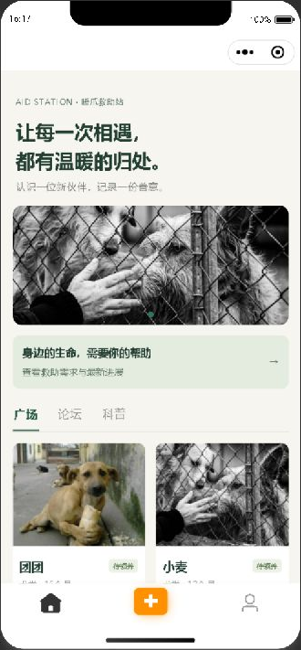
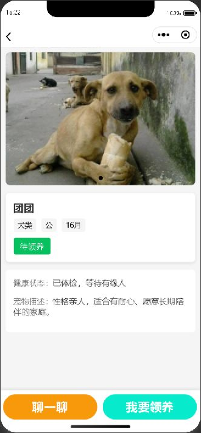
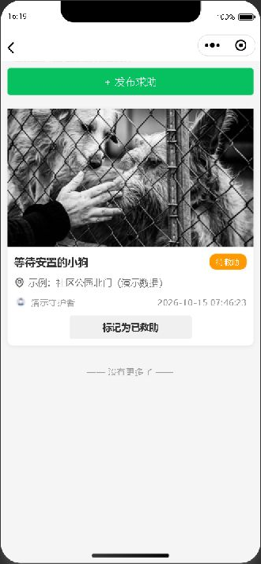
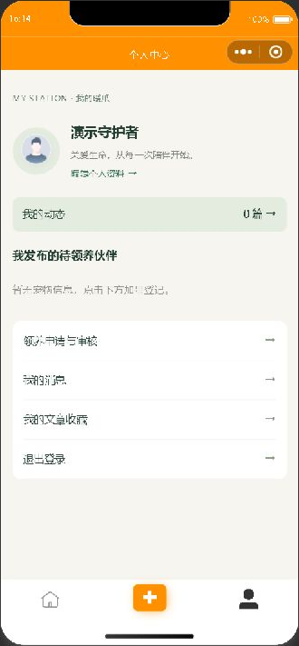
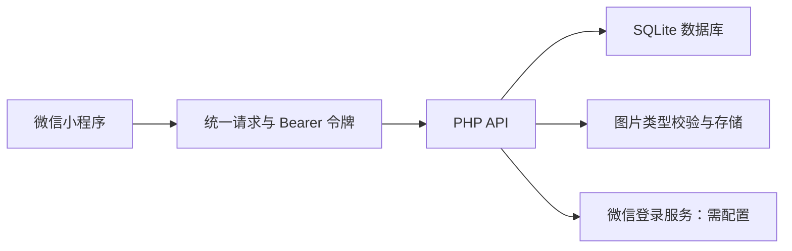

# 暖爪救助站 · Aid Station

微信原生小程序 + PHP 轻量后端，用于流浪动物救助、待领养信息发布和领养沟通。

这个项目由原有小程序修复而来。当前版本以「下载后能复现、核心流程有验证、便于作品集讲解」为目标：移除了对旧服务器的依赖，补齐本地数据库、账号体系、领养申请审核、图片上传与权限控制。

## 运行截图

2026-10-15 在微信开发者工具中实际运行，连接本地 PHP + SQLite 服务。以下截图使用演示账号与示例数据，仅裁剪模拟器区域，未重绘页面。

<table>
  <tr>
    <th>首页 · 待领养广场</th>
    <th>宠物详情 · 领养与沟通入口</th>
  </tr>
  <tr>
    <td></td>
    <td></td>
  </tr>
  <tr>
    <th>救助需求 · 查看进展</th>
    <th>个人中心 · 演示账号登录</th>
  </tr>
  <tr>
    <td></td>
    <td></td>
  </tr>
</table>

## 已实现

| 功能 | 使用方式 |
| --- | --- |
| 宠物广场 | 浏览待领养宠物、查看图片和详情，登录后登记宠物 |
| 领养流程 | 在宠物详情申请；发布者在「我的 → 领养申请与审核」通过或拒绝 |
| 领养状态 | 审核通过后宠物标记已领养，其他待审申请自动拒绝 |
| 救助信息 | 发布求助、查看列表，发布者更新救助状态 |
| 社区动态 | 纯文字或图文发布、动态详情、评论、删除自己的评论 |
| 私信 | 联系宠物发布者、会话列表、未读数、已读标记，前台每 3 秒刷新 |
| 用户资料 | 演示登录、手机号与密码注册登录、头像昵称修改、退出登录 |
| 科普收藏 | 本地文章阅读、标题搜索、文章收藏；收藏保存在当前设备 |

微信正式登录入口已接入服务端 `code2Session` 调用，需要自己的 AppID、AppSecret 和网络环境；本轮未使用真实微信账号验证该流程。手机号在此作为账号名，不包含短信验证。

## 快速开始

依赖：**PHP 8.2+**（启用 `pdo_sqlite`、`fileinfo`、`openssl`），微信开发者工具。测试额外需要 **Node.js 20+**。没有 Composer 或 npm 安装步骤。

```sh
git clone https://github.com/TimeSeas/aid_station.git
cd aid_station
php php/init.php --seed
php -S 127.0.0.1:8082 -t php php/router.php
```

Windows 也可运行：

```powershell
powershell -ExecutionPolicy Bypass -File scripts/start.ps1
```

此脚本优先使用 PATH 中的 PHP；本机已有 `.runtime/php/php.exe` 时可使用该便携运行环境。运行包不会提交到 GitHub，新电脑仍需安装 PHP。初始化可重复执行，不会清空已有数据。

用微信开发者工具导入**仓库根目录**，确认 `project.config.json` 的 AppID 是自己有权限的项目，或通过工具选择测试号；选择工具中可用的基础库。配置中保留原项目 AppID，AppID 是公开标识，不包含 AppSecret。调试时在「详情 → 本地设置」中关闭域名、TLS 和 HTTPS 证书校验。默认接口地址是 `http://127.0.0.1:8082`。

首页应显示 3 条示例宠物。进入「我的 → 体验演示账号」即可使用功能。演示账号为共享测试身份，请填写虚构资料。要演示完整审核流程，注册两个手机号格式的虚构账号，分别扮演发布者和申请人。

真机无法访问电脑的 `127.0.0.1`：应将 `utils/config.js` 的 `baseUrl` 和 `php/config.local.php` 的 `base_url` 改为电脑局域网 IP，同时将本地监听地址改为 `0.0.0.0:8082`，手机与电脑连接同一网络。仅在可信局域网调试。

## 五分钟作品演示

1. 浏览首页广场，进入任意宠物详情，展示待领养信息。
2. 注册账号 A，点击底部加号登记一只宠物；可同时发布一条动态。
3. 退出后注册账号 B，对该宠物发送私信并提交领养申请。
4. 登录账号 A，在「我的消息」回复，在「领养申请与审核」通过申请。
5. 查看宠物已领养状态，再演示发布求助、更新救助状态与文章收藏。

演示数据使用项目现有图片，内容仅用于功能展示，不代表真实救助需求。原始素材的授权归属需由项目所有者确认后再用于对外宣传。

## 结构与设计

```text
pages/                  小程序页面
components/             图标组件
custom-tab-bar/         底部导航和发布入口
utils/config.js         前端地址、演示模式
utils/request.js        请求、鉴权与上传封装
php/actions.php         PHP 业务接口
php/bootstrap.php       输入校验、PDO、令牌鉴权
php/schema.sql          可复现的 SQLite 表结构
php/init.php            仅命令行可运行的初始化与示例数据
php/config.example.php  服务端配置示例
tests/                  前端行为与真实 HTTP 集成测试
docs/                   接口、验证记录和部署示例
var/                    本地数据库（不入库）
```



后端保留原来的 PHP 入口文件名，统一转入同一套业务实现，避免重复维护数据库连接。SQL 使用 PDO 参数化查询；写操作的用户身份来自服务端令牌，不信任前端提交的用户 ID。数据库只保存令牌摘要；密码使用 PHP `password_hash` / `password_verify`。注册用户不能指定管理员权限。

SQLite 适合本地演示和小规模使用。此版本没有迁移旧 MySQL 数据；需要保留历史业务数据时，应先备份并另行编写迁移脚本。

## 验证

```sh
npm test
# 也可分别运行
npm run test:frontend
npm run test:api
```

接口测试会启动自己的临时服务、创建独立测试库，验证后清理，不改动开发数据库。GitHub Actions 会运行语法和自动化检查。详细结果见 [验证记录](docs/verification.md)。

前端测试覆盖页面文件、事件绑定、模块引用、会话恢复、失效登录、失败上传与聊天定时器；本机还使用微信官方编译器检查 WXML/WXSS。已在开发者工具中检查首页、论坛标签切换、宠物详情、演示登录和救助列表，并生成上述截图；编译和模拟器检查不等同于真机验收，真实微信登录、拍照选图和真机布局仍需手机验证。

## 部署和 GitHub 展示

- [部署说明](docs/deployment.md)：正式微信登录、HTTPS、配置和数据库目录权限。
- [接口约定](docs/api.md)：主要动作、返回格式与权限。
- [验证记录](docs/verification.md)：本轮检查及未验证部分。

PHP 内置服务器用于本地调试；对外服务使用 PHP-FPM 与配置好 HTTPS 的 Web 服务器。参见 [PHP 官方内置服务器说明](https://www.php.net/manual/en/features.commandline.webserver.php)。

仓库中不提交本地密钥、数据库、上传图片、便携 PHP 或个人开发工具设置。**旧提交曾包含服务端凭据；删除当前源码中的明文并不能清除 Git 历史，原微信密钥和数据库密码应由所有者在平台中重置。**

这是在原仓库基础上的维护版本，保留原提交记录及贡献者信息。当前未新增开源许可证；项目代码和原始图片的对外授权应由权利人决定。
